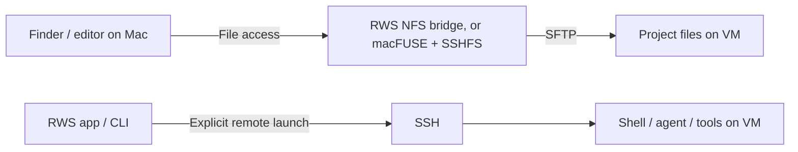

# RWS · Remote Workspace System

**Browse remote project files in Finder. Run development tools on their remote host.**

RWS combines a native macOS app, a Rust CLI and SSH. Your remote machine remains
where the files live and where explicitly launched commands execute.

[Get started](docs/install.md) · [Build from source](docs/development.md) ·
[Architecture](docs/architecture.md) · [Documentation](docs/README.md) ·
[Feature backlog](https://github.com/ssime-git/RWS/issues/1)

> **Development preview.** The app and CLI work on the tested Mac/Tailscale/SSH
> setup. Files are mounted through RWS's own NFS bridge: no macFUSE, no admin
> rights, nothing installed on the VM. There is no published signed release yet;
> installation on a clean Mac, reboot remounting and the app's click-through flow
> are not fully validated. See [tested scope](docs/validation.md).

## Choose your starting point

| You want to… | Start here |
| --- | --- |
| Connect a Mac to a VM you reach over Tailscale | [Connect a Mac to a VM](docs/onboarding.md) |
| Open an existing `RWS.app` by double-clicking | [App user guide](docs/install.md#1-get-the-app) |
| Download a development build without compiling RWS | [Build availability](docs/install.md#build-availability) |
| Compile, test and run the app yourself | [Developer quick start](docs/development.md) |
| Use only the command line | [CLI guide](docs/prototype.md) |
| Keep configured mounts across macOS restarts | [Persistent mounts](docs/install.md#durable-macos-installation) |
| Mount without macFUSE or admin rights | [NFS bridge backend](docs/nfs-bridge.md) |
| Understand which processes run where | [Conceptual architecture](docs/architecture.md) |
| Fix a connection, mounting or Finder problem | [Troubleshooting](docs/troubleshooting.md) |

## How it works today



**Files and execution are separate paths.** The mount backend handles filesystem
operations: RWS's own [localhost NFS bridge](docs/nfs-bridge.md) (default; no
macFUSE, no privileges), or the legacy macFUSE with SSHFS. Neither redirects
arbitrary Mac processes. Execution reaches the VM through the path each tool
offers: the opt-in zsh hook (a `[Y/n]` prompt when a terminal enters a mount),
**Lancer sur la VM** or `rws agent`/`rws exec`/`rws shell`, and Delta's agent
rules. A noninteractive script or an IDE's internal process stays local by
design. The [per-path decision](docs/architecture.md#6-architecture-decision-per-path-integration-no-universal-interception)
and its evidence replace the former "transparent execution" goal
([#1](https://github.com/ssime-git/RWS/issues/1)–[#5](https://github.com/ssime-git/RWS/issues/5), closed).

## A first session

Start from a working Mac and a VM reachable over Tailscale with key-based SSH
([what is expected](docs/onboarding.md#before-you-start)):

1. Double-click **RWS.app**.
2. In **Ajouter une VM**, pick your machine, enter the remote folder and a name,
   and press **Vérifier**. RWS lists anything to fix, with the exact command, and
   installs nothing for you. When it is green, press **Ajouter et monter**.
3. The folder appears at `~/RWS/NAME` and opens in Finder; RWS also attempts to pin
   it in the Finder sidebar and explains the manual fallback if that fails.
   The same flow in a terminal: `rws onboard check` then `rws onboard add`.
4. Enter a remotely installed CLI such as `claude` or `codex`, then choose
   **Lancer sur la VM**. The terminal shows the remote host, OS and directory.
5. Close files using the mount and choose **Déconnecter** when finished.

No agent whitelist is required: the launcher accepts a remote executable name or
absolute path. The agent and its authentication must already be set up on the VM.
An editor extension without a CLI needs its own integration.

## What is available

| Available now | Not yet delivered |
| --- | --- |
| Native macOS app; register/connect/disconnect spaces | Automatic switch for non-zsh shells, scripts and IDE-internal processes (by design) |
| Guided VM onboarding: checks, exact fixes, NFS mount (`rws onboard`) | Signed, notarized public release |
| Opt-in zsh hook: `cd` into a verified mount offers the remote shell | |
| Generic remote agent launcher and explicit SSH commands | General redirection of Delta's native processes |
| Config/dependency discovery and actionable errors | Zero-setup installation on a clean Mac |
| Finder pinning with bookmark renewal and manual fallback | Sessions surviving disconnects and cross-device reattachment |
| Build CI, local bundle replacement and release pipeline | Signed public release and validated user auto-updates |

The existing Delta integration uses personal agent instructions. A tested Delta
workflow is available in the [Delta guide](docs/connection.md#delta-and-linux-commands);
it is not equivalent to native remote execution without instructions.

### Persistent mounts on macOS

After a configuration and its mounts work interactively, `rws install` copies
RWS (and the SSHFS build, with the legacy backend) and the configuration into the user's Application
Support directory. `rws autostart install` then creates one LaunchAgent that
checks eligible workspaces at login and every 30 seconds. Explicit Disconnect
persists a pause, including after reboot, until the next Connect. Existing
configurations without a saved choice retain automatic mounting by default.
Healthy verified mounts are left intact; stalled volumes still require explicit
repair. See the [automatic-remount contract](docs/connection.md#automatic-remount-contract).
This keeps restart recovery out of
the source checkout; see the [durable-install procedure](docs/install.md#durable-macos-installation).

### Diagnose and repair

```sh
rws doctor --json                        # read-only diagnosis
rws repair                              # refresh existing managed integrations
rws repair --workspace demo --mounts     # also recover this workspace if safe
```

Repair saves private before/after reports in the durable installation's
`diagnostics/` directory. It refuses unknown mounts, checks SSH separately from
filesystem responsiveness, and stops if ejection times out. It never restarts
FSKit globally. [Recovery details and limitations](docs/troubleshooting.md#diagnosis-and-repair).
Reopening an updated RWS app refreshes its durable CLI and existing setup;
disabled integrations and custom configurations remain untouched. New LaunchAgent
settings take effect at the next login, not by silently restarting an active service.

## Build the app

On an Apple silicon Mac with [Rust, Xcode and Python 3 ready](docs/development.md#prerequisites):

```sh
git clone --branch prototype/cli https://github.com/ssime-git/RWS.git
cd RWS
rustup target add aarch64-apple-darwin
scripts/build-macos-app.sh development
open dist/development/RWS.app
```

The builder includes the RWS CLI and Sparkle framework. macFUSE and SSHFS are
separate prerequisites for mounting. Quit RWS before rebuilding; the previous
bundle is archived as ZIP and the new build replaces the same path.

## Explore and contribute

- [Documentation map](docs/README.md): user, developer, maintainer and reference guides.
- [Architecture](docs/architecture.md): components, data flow and trust boundaries.
- [Features and linked issues](FEATURES.md): gaps, priorities and acceptance criteria.
- [Roadmap](ROADMAP.md): delivery order, distinct from current capabilities.
- [Contributing](CONTRIBUTING.md): tests, review expectations and private-data rules.

**License selection is pending.** Source availability is not a declared open-source
license. No project license is implied; choose and publish one before distributing
RWS as a licensed open-source release. Third-party components retain their own terms.
